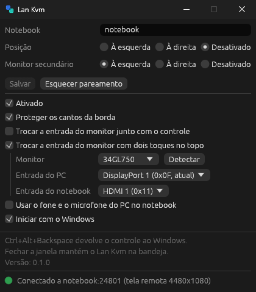

<div align="center">
  <h1>
    <picture>
      <source media="(prefers-color-scheme: dark)" srcset="branding/lan-kvm-horizontal-color-on-dark.svg">
      
    </picture>
  </h1>

  <p>
    KVM por software para compartilhar um teclado e um mouse entre um PC com Windows e um notebook com Linux na mesma rede local, com troca da entrada do monitor por DDC/CI.<br>
  </p>

[](https://github.com/gabrielgriffo/lan-kvm/releases/latest) [](LICENSE) [](https://www.rust-lang.org/)

  <p>
    <a href="https://github.com/gabrielgriffo/lan-kvm/releases/latest">
      </a>
  </p>

</div>

O Lan Kvm transfere o controle do teclado e do mouse do PC para o notebook quando o ponteiro ultrapassa a borda configurada da tela, como em uma configuração de múltiplos monitores. A troca também pode ser acionada por um gesto na borda superior da tela, que alterna a entrada do monitor e transfere o controle para o sistema exibido. A área de transferência é sincronizada a cada troca, e toda a comunicação ocorre diretamente entre as duas máquinas, sem servidores intermediários.

## Início rápido

1. **Instale o receptor no notebook.**

   ```sh
   sudo apt install ./lan-kvm_<versão>_amd64.deb
   ```

   Encerre a sessão e entre novamente. O receptor é iniciado com a sessão gráfica e aguarda conexões na porta TCP 24801. Se houver firewall ativo no notebook, libere essa porta para o endereço do PC.

2. **Instale o aplicativo no PC.** Execute `lan-kvm-<versão>-windows-setup.exe`. Caso o SmartScreen exiba "O Windows protegeu o computador", selecione **Mais informações** e depois **Executar assim mesmo**.

3. **Faça o pareamento.** Na janela do Lan Kvm, informe o IP ou o nome do notebook, selecione a posição dele e clique em **Salvar**. Em seguida, clique em **Parear com o notebook**: um código de 6 dígitos é exibido em uma notificação no notebook. Digite esse código no PC. O pareamento é necessário apenas uma vez.

4. **Transfira o controle.** Mova o ponteiro além da borda correspondente à posição do notebook. Para retornar, mova-o além da borda oposta na tela do notebook. O atalho Ctrl+Alt+Backspace devolve o controle ao Windows a qualquer momento.

## Interface

<p align="center">
  <picture>
    <source media="(prefers-color-scheme: light)" srcset="assets/janela-claro.png">
    
  </picture>
</p>

## Funcionalidades

- **Transição pela borda.** O ponteiro sai pela borda do PC e entra no notebook na mesma altura proporcional. A borda pode ficar à esquerda, à direita ou desativada, e as faixas de 5% no topo e na base podem ser bloqueadas para evitar trocas acidentais.
- **Troca da entrada do monitor.** Com um monitor conectado às duas máquinas, a entrada é alterada por DDC/CI no momento da transferência do controle: o PC seleciona a entrada do notebook, e o notebook seleciona a do PC no retorno.
- **Gesto de dois toques.** Dois toques do ponteiro na borda superior, em menos de 1 s, alternam a entrada do monitor entre o PC e o notebook e transferem o teclado e o mouse para o sistema exibido. A última posição do ponteiro em cada tela é restaurada.
- **Monitor secundário.** Com o monitor principal exibindo o notebook, o ponteiro pode sair pela borda lateral configurada e retornar ao PC no monitor adjacente, sem alterar a entrada do principal.
- **Controle bidirecional.** O teclado e o touchpad do notebook também controlam o PC pela borda voltada para ele.
- **Aceleração equivalente.** O PC aplica a curva de aceleração e a velocidade configuradas no Windows ao movimento enviado, de modo que o ponteiro se comporta igual nas duas telas.
- **Área de transferência.** O texto copiado é sincronizado a cada troca de controle, nos dois sentidos.
- **Áudio.** Opcionalmente, a saída de áudio do notebook é reproduzida no dispositivo do PC, e o microfone do PC é disponibilizado como entrada no notebook.
- **Retorno do monitor.** Se o notebook for desligado, a sessão for encerrada ou a conexão cair com o monitor na entrada do notebook, a entrada do PC é restaurada.
- **Execução em segundo plano.** Ao fechar a janela, o Lan Kvm permanece na área de notificação, e pode ser iniciado com o Windows. Uma nova execução apenas traz a instância existente para o primeiro plano.
- **Comunicação local.** O PC se conecta diretamente ao notebook por um canal cifrado e autenticado, estabelecido após o pareamento. Não há conta, servidor intermediário, telemetria nem verificação de atualizações. Detalhes em [SECURITY.md](SECURITY.md).

## Configurações

Todas as opções ficam na janela do PC. O receptor no notebook não tem configuração própria.

| Opção | Descrição |
|---|---|
| Notebook | IP ou nome do notebook na rede. |
| Posição | Lado do PC em que o notebook está: à esquerda, à direita ou desativado (troca apenas pelos dois toques). |
| Monitor secundário | Disponível apenas com a Posição desativada. Lado do monitor principal em que fica outro monitor do PC, usado como saída enquanto o notebook está em exibição. |
| Esquecer pareamento | Remove o segredo do pareamento deste PC. |
| Ativado | Ativa ou desativa o Lan Kvm sem encerrar o aplicativo. |
| Proteger os cantos da borda | Impede a troca nas faixas de 5% superior e inferior da borda. |
| Trocar a entrada do monitor junto com o controle | Define o monitor e as entradas do PC e do notebook. |
| Trocar a entrada do monitor com dois toques no topo | Ativa o gesto, com monitor e entradas próprios. |
| Usar o fone e o microfone do PC no notebook | Ativa o áudio e exibe o dispositivo em uso em cada lado. |
| Iniciar com o Windows | Inicia o Lan Kvm na área de notificação ao entrar no Windows. |

O estado da conexão é exibido no rodapé da janela e pela cor do ícone na área de notificação: cinza (desativado), laranja (aguardando o notebook), verde (conectado) e azul-turquesa (controle no notebook).

## Limitações conhecidas

- **Topologia fixa.** Um PC com Windows e um notebook com Linux. Não há suporte a macOS, a pares de máquinas Windows ou a mais de um notebook.
- **Requisitos.** PC com Windows 10 ou 11, 64 bits. Notebook com Ubuntu 22.04 ou superior (glibc 2.35+), 64 bits. As duas máquinas precisam executar a mesma versão do Lan Kvm.
- **Somente X11.** No Wayland, o receptor não consegue injetar nem capturar eventos de teclado e mouse.
- **Somente texto na área de transferência**, com limite de 1 MiB. Arquivos não são transferidos.
- **Dependência do monitor.** A troca de entrada exige suporte a DDC/CI, e alguns monitores usam códigos de entrada fora do padrão; nesse caso, vale o código que funcionar.
- **Instalador sem assinatura.** O SmartScreen e alguns antivírus podem solicitar confirmação na primeira execução.

## Detalhes técnicos

<details>
<summary><strong>Estados da conexão</strong></summary>

| Estado | Significado |
|---|---|
| `Desativado` | O Lan Kvm foi desativado na janela ou no menu da área de notificação. |
| `Conectando a <endereço>…` | O PC está tentando estabelecer a conexão com o notebook. |
| `Sem conexão com <endereço>: <erro>` | O notebook não respondeu. Verifique se ele está ligado, em uma sessão X11 e com a porta 24801 liberada. |
| `Este PC ainda não está pareado com <endereço>` | O pareamento não foi feito. Clique em **Parear com o notebook**. |
| `Conectado a <endereço> (tela remota LxA)` | Conexão cifrada estabelecida, com o controle no PC. |
| `Controle no notebook (<endereço>)` | O teclado e o mouse do PC estão controlando o notebook. |
| `Notebook controlando o PC (<endereço>)` | O teclado e o touchpad do notebook estão controlando o PC. |

Quando a conexão cai, o controle retorna imediatamente ao PC e, se o monitor estava na entrada do notebook, a entrada do PC é restaurada.

</details>

<details>
<summary><strong>Troca da entrada do monitor</strong></summary>

O monitor aceita comandos DDC/CI apenas pela entrada que está exibindo. Por isso, o PC seleciona a entrada do notebook, e o notebook seleciona novamente a do PC. No PC, o botão **Detectar** lista os monitores que respondem e as entradas de cada um. No notebook, o pacote `.deb` carrega o módulo `i2c-dev` e concede ao usuário da sessão acesso ao barramento, sem exigir root.

Para que o monitor não fique preso em uma máquina sem controle, o receptor restaura a entrada do PC ao ser encerrado, seja por desligamento, fim da sessão ou queda da conexão.

</details>

<details>
<summary><strong>Gesto de dois toques e monitor secundário</strong></summary>

Dois toques na borda superior, com intervalo de até 1 s, alternam o monitor configurado entre a entrada do PC e a do notebook. O gesto é reconhecido pelo mouse do PC, esteja o ponteiro na tela do PC ou na do notebook (o touchpad do notebook não é considerado), e funciona independentemente da Posição, inclusive com ela desativada.

Após a troca, o ponteiro é posicionado no último ponto em que esteve naquela tela. Na primeira troca, ou se esse ponto estiver fora da área visível, ele é centralizado no monitor.

Com a Posição desativada, a opção **Monitor secundário** indica de que lado do monitor principal, aquele cuja entrada é alternada pelos dois toques, fica outro monitor do PC. Enquanto o monitor principal exibe o notebook, o ponteiro que sai pela borda desse lado retorna ao PC no monitor adjacente, na mesma altura proporcional, sem alterar a entrada. Ao voltar desse monitor para o principal, o controle passa novamente ao notebook pela mesma borda. A saída ocorre sempre pela borda do monitor principal, mesmo que o notebook tenha outra tela naquele lado.

</details>

<details>
<summary><strong>Teclado, mouse e área de transferência</strong></summary>

O PC lê o movimento bruto do mouse (Raw Input) e aplica a curva de aceleração do Windows antes do envio, de modo que a velocidade no notebook corresponde à do PC. Com o controle no notebook, o cursor do Windows é ocultado por uma janela transparente posicionada sob ele, sem alterar os cursores do sistema.

As teclas são transmitidas pela posição física (scancode), e o layout aplicado é o do notebook. O atalho Ctrl+Alt+Backspace é sempre tratado pelo PC: devolve o controle ao Windows e não é encaminhado.

A área de transferência é sincronizada no momento da troca de controle, apenas quando houve alteração desde a última troca. Somente texto é transferido, com limite de 1 MiB.

</details>

<details>
<summary><strong>Áudio</strong></summary>

Com a opção ativada, o notebook captura a própria saída de áudio e a envia ao PC, que a reproduz no dispositivo de saída padrão do Windows. No sentido inverso, o microfone padrão do PC é disponibilizado como entrada no notebook. No notebook, o recurso usa PulseAudio ou PipeWire por meio de `pactl`, `parec` e `pacat`, já incluídos no Ubuntu. O áudio trafega cifrado pela mesma conexão.

</details>

<details>
<summary><strong>Linha de comando</strong></summary>

```text
lan-kvm                                abre a interface (Windows)
lan-kvm send <host[:porta]> [--left] [--protect-corners] [--monitor NOME,PC,NOTEBOOK [--monitor-now]]
                                       captura mouse e teclado sem interface (Windows)
lan-kvm pair <host[:porta]>            pareia com o notebook (Windows)
lan-kvm recv [endereço:porta]          recebe mouse e teclado (Linux X11)
lan-kvm unpair                         remove o pareamento desta máquina
lan-kvm monitors                       lista monitores e entradas por DDC/CI
lan-kvm --version                      mostra a versão
```

No Windows, o executável instalado fica em `%LOCALAPPDATA%\Programs\Lan Kvm\Lan Kvm.exe`. Após o pareamento, o notebook recusa novos pareamentos até que `lan-kvm unpair` seja executado nele.

</details>

<details>
<summary><strong>Compilação</strong></summary>

Pré-requisitos:

- [Rust](https://www.rust-lang.org/tools/install) 1.99.1, versão fixada em `rust-toolchain.toml`
- No Windows, para gerar o instalador: [Inno Setup 6](https://jrsoftware.org/isinfo.php)
- No Linux: `pkg-config` e os pacotes de desenvolvimento do X11 (`libx11-dev`, `libxi-dev`, `libxtst-dev`, `libxcb1-dev`, `libxkbcommon-dev`, `libxkbcommon-x11-dev`), ou Docker

```powershell
# Windows: fmt, clippy, testes e build release
.\scripts\build-windows.ps1

# Windows: instalador em target\installer (com -Install, instala nesta máquina)
.\scripts\package-windows.ps1
```

```sh
# Linux: compila e testa em um container Ubuntu 22.04
bash scripts/build-linux-docker.sh

# Linux: gera o .deb a partir do binário
bash scripts/package-deb.sh <binário>
```

A partir do PC, `.\scripts\build-linux-remote.ps1 -Target usuario@notebook -Install` copia o código para o notebook, compila no container e instala o receptor em `~/.local/bin`.

O código é dividido em dois crates. `crates/core` contém o protocolo, o pareamento, a criptografia, as regras de troca de tela e a aceleração do mouse, sem dependências de sistema operacional. `crates/app` contém a parte do Windows (interface, captura e DDC) e a do Linux X11 (receptor, captura e DDC).

</details>

## Licença e suporte

Distribuído sob a licença MIT. Consulte [LICENSE](LICENSE).

O Lan Kvm é mantido por uma única pessoa. Issues são bem-vindas, mas não há prazo garantido de resposta. Vulnerabilidades devem ser reportadas de forma privada, conforme descrito em [SECURITY.md](SECURITY.md).

Ao relatar um problema, anexe os logs das duas máquinas: `%LOCALAPPDATA%\lan-kvm\lan-kvm.log` no PC e `~/.local/state/lan-kvm/recv.log` no notebook. Eles contêm endereços IP e nomes de monitores; revise o conteúdo antes de publicá-lo.

MIT © [Gabriel Griffo](https://github.com/gabrielgriffo)
